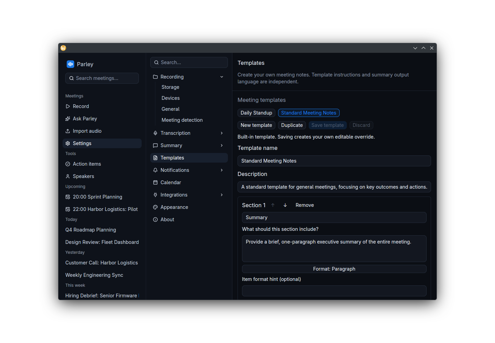

# Transcription and AI models

Parley uses two kinds of model:

- a **transcription model** (Whisper), which turns speech into text. It always runs on your computer.
- a **language model**, which writes summaries, chapters, action items, follow-up emails and briefs, and answers your questions in Ask. You choose where this runs.

## Transcription (Whisper)

**Settings → Transcription** lists every Whisper model under **Model catalog**, with its accuracy, size and status. Click **Download** to fetch one (from Hugging Face), **Cancel** to stop a download and **Delete** to remove it. Pick the model used for live transcription under **Active model → Whisper model**; only downloaded models are listed.

| Model | Accuracy | Size |
|---|---|---|
| tiny-q5_1 / tiny | Decent | 31 MB / 74 MB |
| base-q5_1 / base | Good | 57 MB / 142 MB |
| small-q5_1 / small | Good | 181 MB / 466 MB |
| medium-q5_0 / medium | High | 514 MB / 1.5 GB |
| **large-v3-turbo-q5_0** (default) | High | 547 MB |
| large-v3-turbo | High | 1.5 GB |
| large-v3-q5_0 | High | 1.0 GB |
| large-v3 | High | 2.9 GB |

The `q5` variants are compressed versions that are much smaller and nearly as accurate. The default, **large-v3-turbo-q5_0**, is the best balance for most people. Smaller models are faster on slow CPUs; the larger `large-v3` models are the most accurate.

> [!TIP]
> Download **large-v3-q5_0** as well as your live model. After each recording, Parley then automatically re-transcribes the meeting with it in the background for a more accurate final transcript. It never downloads a model for this on its own.

Every model understands many languages. To fix the language instead of detecting it, set **Settings → Summary → Language & summaries → Transcription language** to a language code such as `en`, `fr` or `de`. Leave it blank to detect the language automatically.

Transcription uses your GPU when you installed the Vulkan build (or built Parley with CUDA), and the CPU otherwise. There is no setting for this.

### Custom vocabulary

Whisper may misspell names, products and acronyms it hasn't heard of. Under **Settings → Transcription → Custom vocabulary**, add each **Term** the way you want it spelled, optionally with what it **Sounds like** (for example *Kubernetes*, sounds like *cooper netties*).

- The **Whisper prompt preview** shows exactly what Whisper is given. There is room for roughly a dozen or two terms; Parley warns you about terms that don't fit.
- **Include speaker and attendee names** also adds the names of your [speakers](speakers.md) and of the people invited to the meeting's calendar event.
- **Correct near-miss spellings** fixes close misspellings of your terms after transcription.

Custom vocabulary is applied when a meeting is refined after recording, re-transcribed or imported. It isn't applied to the live transcript.

## Language model for summaries and Ask

Choose a **Provider** under **Settings → Summary**:

| Provider | Runs | What you need |
|---|---|---|
| **Built-in AI (local)** (default) | On your computer | Nothing: pick a model under *Built-in AI models* |
| **Ollama** | On your computer, or a server you run | Ollama installed, and its **Endpoint** if it isn't `http://localhost:11434` |
| **OpenAI**, **Claude**, **Groq**, **OpenRouter** | In the provider's cloud | An API key from that provider |
| **Custom OpenAI-compatible** | Wherever the server is | Its **Endpoint URL**, **Model** name and, if required, an API key |

### Built-in AI

Runs entirely on your computer with llama.cpp. There are two models:

- **Gemma 3 1B (Fast)**: about 1 GB to download and 1 GB of memory. The default.
- **Gemma 3 4B (Balanced)**: about 2.3 GB to download and 3.5 GB of memory. Noticeably better summaries if your computer can spare the memory.

**Download** a model and click **Select** to use it.

### Ollama

Install [Ollama](https://ollama.com), then choose **Ollama** as the provider and pick one of your installed models. You can also type a model name (such as `gemma3:4b`) and click **Pull model** to download it from inside Parley.

With Ollama as the provider, Parley also uses it for [semantic search](ask.md#keyword-and-semantic-search) instead of its built-in model. Pull the embedding model once:

```bash
ollama pull nomic-embed-text
```

### Cloud providers

Paste your key under **API keys**, then choose a model from the list Parley fetches from the provider. Keys are saved in Parley's local database in plain text, so anyone with access to your user account could read them.

> [!WARNING]
> With a cloud provider, the meeting transcript is sent to that provider whenever you generate a summary, ask a question or use any other AI feature. Their privacy policy then applies. The built-in model and a local Ollama keep everything on your computer.

### Other summary settings

- **Templates → Default summary template**: the template pre-selected when you generate a summary. See [Meeting notes](meetings.md).
- **Auto-summarize after recording**: write the summary automatically when a recording stops. Off by default.
- **Auto-generate chapters after recording**: split each new meeting into chapters automatically. Until you change it, it follows *Auto-summarize after recording*.
- **Show transcription confidence**: show a coloured dot by each transcript line for how sure Whisper was of it. On by default.

## Summary templates and output language



Open **Settings → Templates** to create a template or duplicate an existing one.
Edit its name, description and sections. Each section has a title, instructions,
a paragraph/list/short-text format, and an optional item-format hint. Use the
arrows to reorder sections, then **Save template**. **Discard changes** restores
the saved version. **Use as default** selects it for summaries; the meeting's
summary toolbar can also select another template.

Editing a built-in template saves a local override. **Restore built-in** removes
that override and restores the original. Custom templates can be deleted; removal
requires confirmation. Template files stay in the application data directory and
survive application updates. Existing generated summaries keep their saved text.

Under **Settings → Summary → Language & summaries**, choose **Summary output
language** independently of the template and transcription language. **Follow
transcript** uses the predominant language of the meeting. For example, choose
**Español** to keep an English template but generate Spanish notes, titles and
section headings. Regenerate a previous summary to apply a new template or
language. The preference applies to summary reports (including automatic summaries)
and newly generated or regenerated follow-up emails. Email subjects, greetings,
section labels and sign-offs follow the same language. With **Follow transcript**,
an excerpt of the original meeting guides the email language even when an older
summary is in English. Existing email drafts and manual edits are preserved until
you choose to regenerate.
